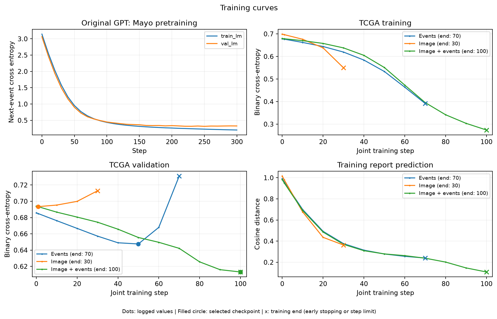
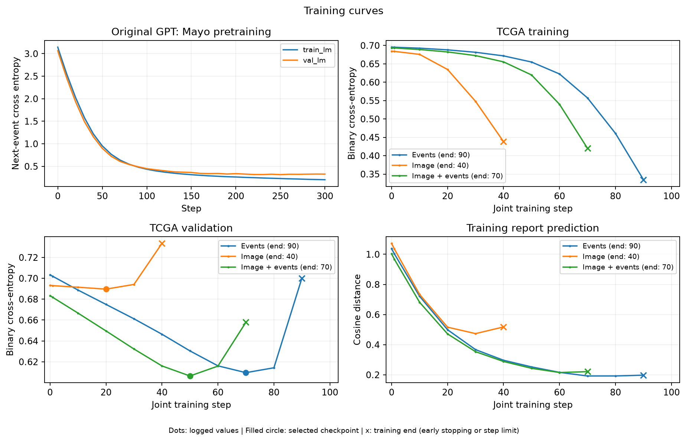
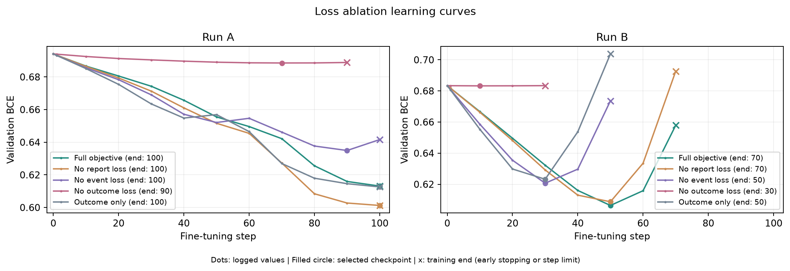

# PathAI

[中文](README.zh-CN.md) · [Interactive walkthrough](showcase/index.html)

PathAI extends the supplied event GPT (`ToyAesclea`). Frozen Phikon patch features are averaged and projected into one image prefix token, followed by clinical event tokens. The original GPT predicts `death_recorded` from events, an image, or both. Frozen PLIP report embeddings provide auxiliary supervision.

Stage 2 minimizes **outcome BCE + 0.1 × event CE + 0.1 × report cosine loss**. Event and report losses combine Mayo and TCGA training patients. TCGA event inputs end at the first resection; the label records whether `DEATH` appears in the complete record.

## Run

Use Python 3.10+ and CUDA-enabled PyTorch for feature extraction. All model and training code is included in this repository. Run commands from `PathAI/`; use new output directories for new experiments.

Place the dataset under `data/` as shown below, or pass `--data-dir /path/to/data` to the preparation command. Data and pretrained weights remain outside Git.

```text
data/
├── mayo/
│   ├── train.jsonl
│   ├── val.jsonl
│   └── reports/
└── tcga/
    ├── tcga.jsonl
    ├── reports/
    └── slides/
```

### Step 0: Install dependencies and download the frozen encoders

```bash
pip install -e '.[encoders]'
python -c 'from huggingface_hub import snapshot_download; snapshot_download("owkin/phikon", local_dir="artifacts/pretrained/phikon"); snapshot_download("vinid/plip", local_dir="artifacts/pretrained/plip")'
export OPENBLAS_NUM_THREADS=1 OMP_NUM_THREADS=1
```

### Step 1: Validate records and prepare cleaned report copies

```bash
python -m pathai.data
```

### Step 2: Pretrain the original event GPT on Mayo

```bash
python -m pathai.train --stage pretrain --out artifacts/pretrain
```

### Step 3: Encode slide patches with Phikon and reports with PLIP

```bash
python -m pathai.extract_images
python -m pathai.encode_reports
```

### Step 4: Fine-tune the three input modes

```bash
for run in a b; do
  python -m pathai.train --stage finetune --experiment "$run" \
    --pretrained-run artifacts/pretrain --out "artifacts/run_$run"
done
```

### Step 5: Evaluate and export training curves

```bash
for run in a b; do
  python -m pathai.evaluate --run "artifacts/run_$run" --out "results/run_$run"
done
```

### Step 6: Ablate the Stage 2 losses with image + events

```bash
python -m pathai.ablate --pretrained-run artifacts/pretrain \
  --out artifacts/ablation --results results/ablation
```

## Results

Selected development-validation runs: 6 TCGA training / 4 validation patients. Validation BCE selects checkpoints and runs; accuracy uses a 0.5 threshold. Mayo pretraining validation CE: **0.3277**.

| Run | Input | Accuracy ↑ | BCE ↓ | AUROC ↑ |
|---|---|---:|---:|---:|
| A | Events | 50% | 0.6476 | 0.50 |
| A | Image | 50% | 0.6934 | 0.25 |
| A | Image + events | 75% | 0.6131 | 0.50 |
| B | Events | 50% | 0.6096 | 1.00 |
| B | Image | 50% | 0.6896 | 0.50 |
| B | Image + events | 75% | 0.6064 | 1.00 |

Curves end at the actual stopping step (shown in the legend): dots are logged values, filled circles mark selected checkpoints, and × marks training end. Early stopping uses 20 steps without improvement; 100 steps is the maximum. Metrics are logged at steps 0, 1, and every 10 steps.





### Stage 2 loss ablation

All variants use image + events, the same pretrained weights, patient split, initialization, optimizer, and checkpoint rule within each run. Only loss weights change.

| Objective | A accuracy ↑ | A BCE ↓ | B accuracy ↑ | B BCE ↓ |
|---|---:|---:|---:|---:|
| Full objective | 75% | 0.6131 | 75% | 0.6064 |
| No report loss | 75% | 0.6013 | 75% | 0.6087 |
| No event loss | 75% | 0.6349 | 75% | 0.6207 |
| No outcome loss | 50% | 0.6886 | 75% | 0.6832 |
| Outcome only | 75% | 0.6126 | 75% | 0.6232 |

Removing event or outcome loss increases BCE in both runs. Report supervision slightly lowers BCE in Run B and raises it in Run A.



[Ablation metrics](results/ablation/metrics.json) · [Metric comparison](results/ablation/comparison.png)
