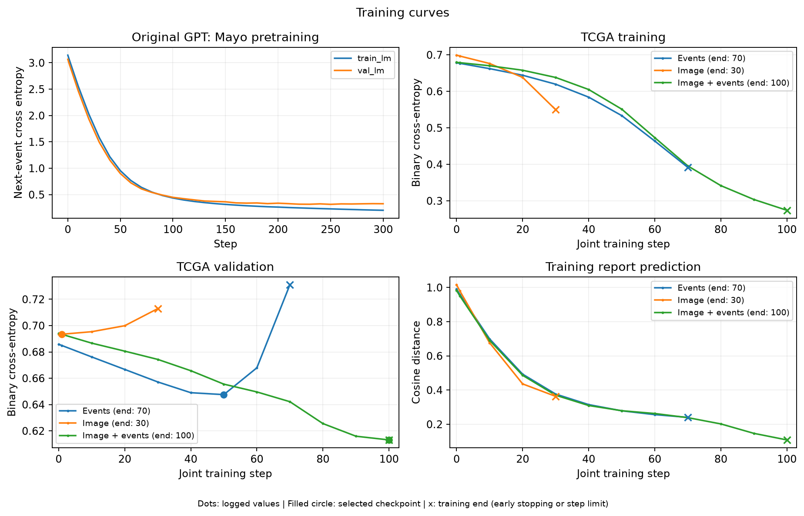
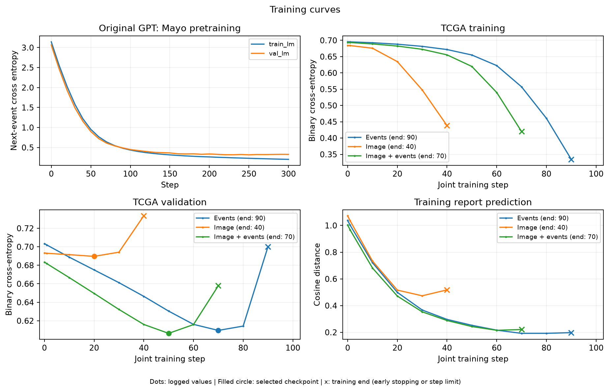
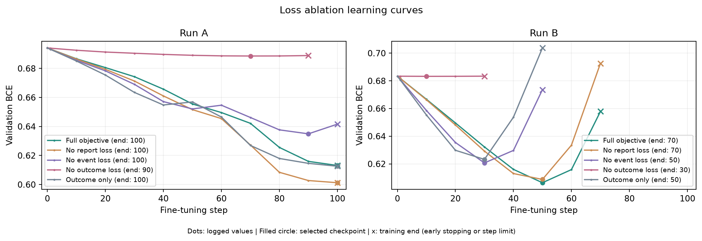

# PathAI

[English](README.md) · [交互式流程展示](showcase/index.html)

在原项目事件 GPT（`ToyAesclea`）上增加图像输入：冻结的 Phikon 提取组织块特征，平均后投影为一个图像前缀 token，再与临床事件一起进入原 GPT。模型支持事件、图像和联合输入，预测 `death_recorded`；冻结的 PLIP 报告向量提供辅助监督。

Stage 2 的目标为 **结局 BCE + 0.1 × 事件 CE + 0.1 × 报告余弦损失**。事件与报告损失来自 Mayo 和 TCGA 训练患者。TCGA 事件输入截至首次手术切除，标签表示完整记录中是否出现 `DEATH`。

## 运行

使用 Python 3.10+；特征提取需要支持 CUDA 的 PyTorch。原项目 `aesclepius-jr/` 与 `PathAI/` 放在同一目录下。以下命令在 `PathAI/` 中执行，新实验使用新的输出目录。

### Step 0：安装依赖，下载冻结的编码器

```bash
pip install -e '.[encoders]'
python -c 'from huggingface_hub import snapshot_download; snapshot_download("owkin/phikon", local_dir="artifacts/pretrained/phikon"); snapshot_download("vinid/plip", local_dir="artifacts/pretrained/plip")'
export OPENBLAS_NUM_THREADS=1 OMP_NUM_THREADS=1
```

### Step 1：检查数据格式，生成清洗后的报告副本

```bash
python -m pathai.data
```

### Step 2：使用 Mayo 数据预训练原始事件 GPT

```bash
python -m pathai.train --stage pretrain --out artifacts/pretrain
```

### Step 3：用 Phikon 编码组织图像，用 PLIP 编码报告

```bash
python -m pathai.extract_images
python -m pathai.encode_reports
```

### Step 4：分别微调事件、图像和联合输入模型

```bash
for run in a b; do
  python -m pathai.train --stage finetune --experiment "$run" \
    --pretrained-run artifacts/pretrain --out "artifacts/run_$run"
done
```

### Step 5：评估模型，导出训练曲线

```bash
for run in a b; do
  python -m pathai.evaluate --run "artifacts/run_$run" --out "results/run_$run"
done
```

### Step 6：在联合输入下进行 Stage 2 损失消融

```bash
python -m pathai.ablate --pretrained-run artifacts/pretrain \
  --out artifacts/ablation --results results/ablation
```

## 结果

以下为选中的开发验证实验：TCGA 6 人训练、4 人验证；验证 BCE 用于选择检查点和实验，准确率使用 0.5 阈值。Mayo 预训练验证 CE 为 **0.3277**。

| Run | 输入 | 准确率 ↑ | BCE ↓ | AUROC ↑ |
|---|---|---:|---:|---:|
| A | 事件 | 50% | 0.6476 | 0.50 |
| A | 图像 | 50% | 0.6934 | 0.25 |
| A | 图像 + 事件 | 75% | 0.6131 | 0.50 |
| B | 事件 | 50% | 0.6096 | 1.00 |
| B | 图像 | 50% | 0.6896 | 0.50 |
| B | 图像 + 事件 | 75% | 0.6064 | 1.00 |

曲线绘制到实际停止步数（见图例）：小点为日志记录值，实心圆为选中的检查点，× 为训练终点。连续 20 步未改善时早停，100 步是训练上限；指标在第 0、1 步及每 10 步记录。





### Stage 2 损失消融

所有方案均使用图像 + 事件；同一 Run 内固定预训练权重、患者划分、初始化、优化器和检查点选择规则，只改变损失权重。

| 训练目标 | A 准确率 ↑ | A BCE ↓ | B 准确率 ↑ | B BCE ↓ |
|---|---:|---:|---:|---:|
| 完整目标 | 75% | 0.6131 | 75% | 0.6064 |
| 去掉报告损失 | 75% | 0.6013 | 75% | 0.6087 |
| 去掉事件损失 | 75% | 0.6349 | 75% | 0.6207 |
| 去掉结局损失 | 50% | 0.6886 | 75% | 0.6832 |
| 仅结局损失 | 75% | 0.6126 | 75% | 0.6232 |

去掉事件或结局损失，两组 BCE 均上升；报告监督使 Run B 的 BCE 略降、Run A 的 BCE 上升。



[消融指标](results/ablation/metrics.json) · [指标对比图](results/ablation/comparison.png)
