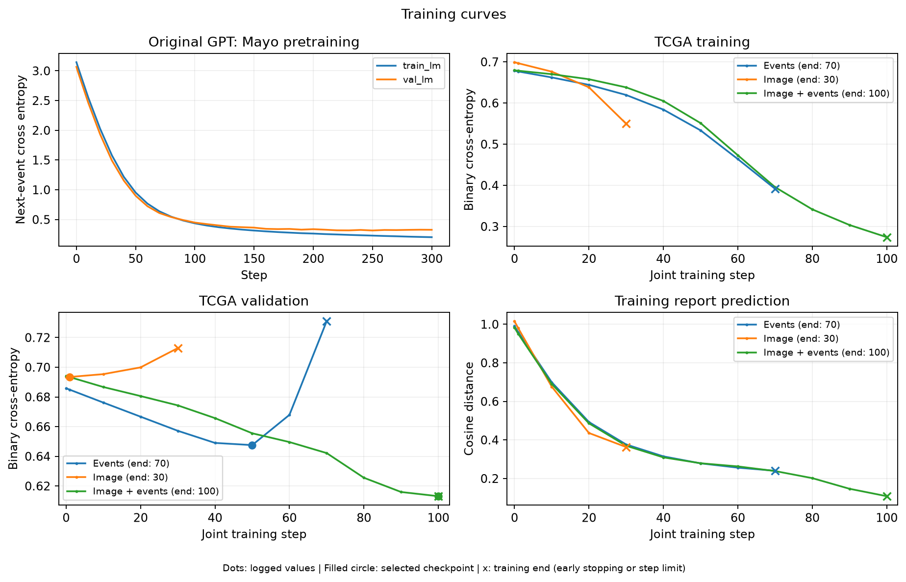
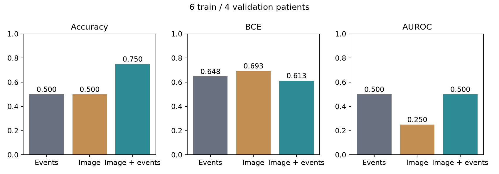
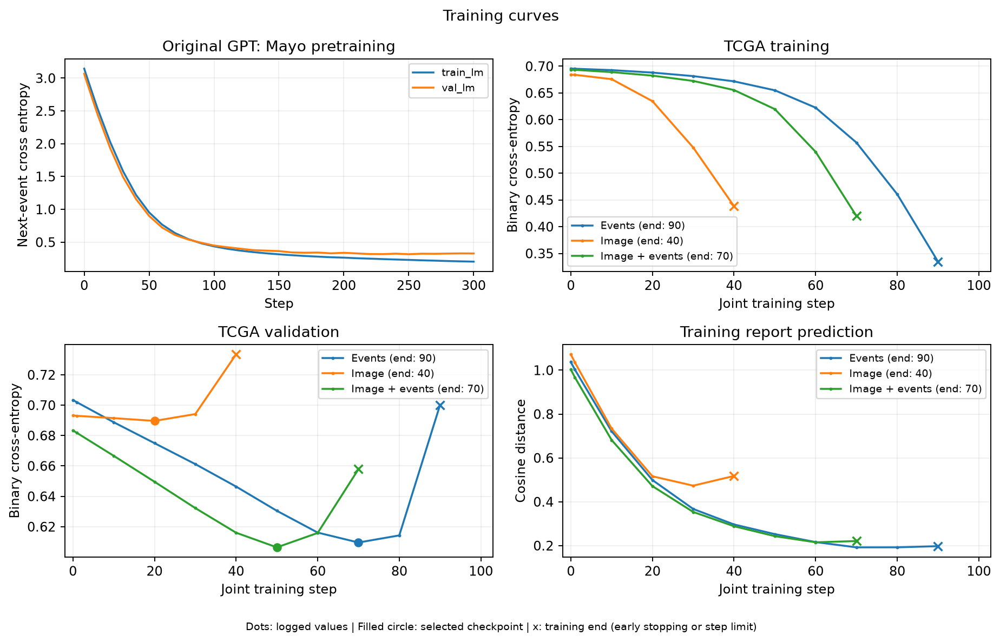
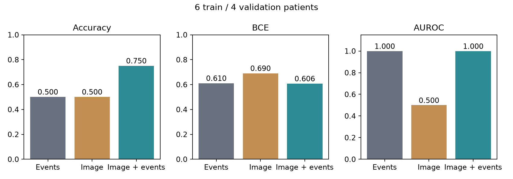
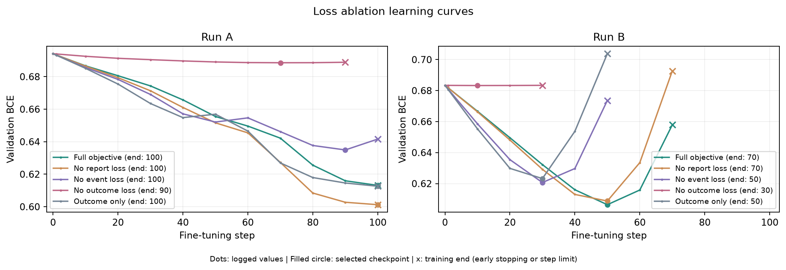
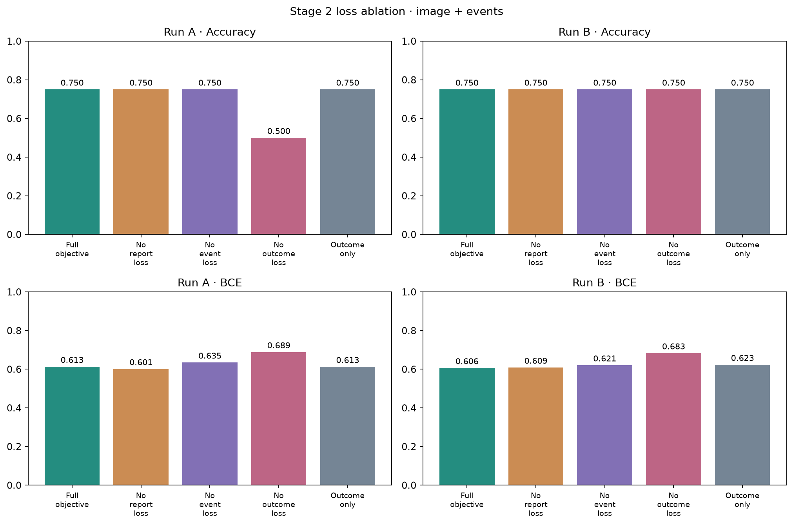

# PathAI: Data Processing, Model Training, and Evaluation

An H&E pathology slide becomes one image prefix token, followed by clinical event tokens in the original GPT. The model predicts whether the patient's complete record contains `DEATH`. Next-event prediction and report semantics provide additional training objectives. Temporal context comes from event order; timestamps and elapsed intervals are not inputs.

## 1. Validate records and prepare cleaned copies

```bash
python -m pathai.data
```

### Datasets and patient matching

| Dataset | Patients | Events | Reports | Images |
|---|---:|---|---:|---:|
| Mayo train | 40 | Synthetic sequences | 27 | None |
| Mayo validation | 10 | Synthetic sequences | 9 | None |
| TCGA | 10 | Clinical sequences | 10 | 10 SVS slides |

Event files use JSONL: one `{"patient_id": ..., "events": [...]}` record per line. Patient IDs match event records to report and slide filenames.

### Event checks and outcome labels

Validation checks the required fields, patient ID type and uniqueness, event-list length, nonempty event strings, and surrounding whitespace. TCGA records must have matching report and slide files.

TCGA inputs end at the first `PROC_RESECTION`, including that event. A retained prefix containing `DEATH` or `EVENT_PROGRESSION` triggers an error. The complete record defines the label: 1 if `DEATH` is present, otherwise 0.

`TCGA-50-6591`:

```text
Complete record:
DEMO_SEX_F → AGE_60S → SMOKE_NEVER → DIAG_C34
→ STAGE_T2 → STAGE_N0 → STAGE_M1 → MUT_EGFR → MUT_TP53
→ PROC_RESECTION → EVENT_PROGRESSION → DEATH

Event input: first 10 events, through PROC_RESECTION
Outcome label: 1
```

Mayo retains complete sequences for next-event prediction. Event names map to integer IDs; ID 0 is padding. The vocabulary expands from 20 to 48 entries, including padding. Sequences are right-padded to the longest sequence in the batch. Mayo allows up to 64 events; TCGA allows 63, reserving one position for the image token.

### Report cleaning and availability

Cleaning applies Unicode NFC normalization, standardizes line endings, collapses repeated spaces and tabs, and strips surrounding whitespace from each line. It writes separate copies while preserving source files and clinical wording.

| Readability check | Requirement |
|---|---|
| Word count | At least 20 English word tokens |
| Word fragmentation | At least 45% of words have three or more characters |
| Character composition | At least 55% of non-whitespace characters are alphabetic |
| Invalid characters | No replacement or null characters |
| Clinical vocabulary | At least one clinical keyword, such as carcinoma, histology, or lung |

Of 46 reports, 45 pass. The report for `TCGA-35-4122` is excluded from report loss; its image, events, and outcome label remain available.

Outputs: `artifacts/processed/patients.jsonl`, `vocab.json`, `quality.json`, and cleaned copies under `reports/`.

## 2. Stage 1: Pretrain the original event GPT

```bash
python -m pathai.train --stage pretrain --out artifacts/pretrain
```

The original `ToyAesclea` and `ToyConfig` implementation is included in `src/pathai/gpt.py`. The original event vocabulary and batching utilities are included in `src/pathai/events.py`. All imports stay within the package.

### Backbone architecture

```text
Event IDs [B,T]
  → token embedding [B,T,64]
  + learned position embedding [B,T,64]
  → 2 Transformer blocks
      x = x + CausalSelfAttention(LayerNorm(x))
      x = x + MLP(LayerNorm(x))
  → final LayerNorm [B,T,64]
  → LM head [B,T,20]
```

Each layer has two attention heads with 32 dimensions per head. The MLP is `64 → 256 → GELU → 64`. Attention is causal, the maximum context length is 64, and there is no dropout. The language head has no bias and does not share weights with the token embedding.

Each event position predicts the next event: `events[:-1]` aligns with `events[1:]`. Cross-entropy ignores padding targets.

| Setting | Stage 1 |
|---|---|
| Training / validation | 40 / 10 Mayo patients |
| Parameters | **106,752** |
| Training steps | 300 |
| Batch size | 32 patients sampled without replacement within each step |
| Optimizer | AdamW, β=(0.9, 0.999), ε=1e-8 |
| Learning rate | Constant 3e-4 |
| Weight decay | 0.01 |
| Precision / device | FP32 / CPU, two PyTorch compute threads |
| Gradient clipping | Disabled in this stage |
| Validation logging | Steps 0, 1, and every 10 steps |

The stage saves `gpt_pretrained.pt` and `pretraining.json`. Validation cross-entropy reaches **0.3277** after 300 steps. Downstream models inherit these GPT weights.

## 3. Convert a whole slide into features and an image token

```bash
python -m pathai.extract_images
```

SVS files contain whole-slide scans of H&E-stained tissue.

1. **Locate tissue.** Generate a thumbnail with a maximum dimension of approximately 1,024 pixels. Tissue pixels require HSV saturation >25 and mean RGB intensity between 20 and 235, excluding white background and very dark regions.
2. **Choose regions.** Target approximately 0.5 µm/pixel and use the slide's native resolution to select a pyramid level and reading-window size. Windows must lie within slide boundaries, occupy distinct sampling-grid cells, and contain at least 50% tissue. Sample 256 regions. The experiments reuse coordinates in `configs/regions.json`.
3. **Prepare pixels.** Composite transparency onto white, convert to RGB, and resize each region to 224×224. Divide pixels by 255, then normalize with mean `[0.485, 0.456, 0.406]` and standard deviation `[0.229, 0.224, 0.225]`.
4. **Encode with frozen Phikon.** Use ViT-B/16 in evaluation/inference mode on CUDA, with eight patches per batch. Extract each patch's CLS feature to obtain `[256,768]`.
5. **Cache features.** Save one NPZ per patient containing patch features and sampling coordinates. During fine-tuning, average the 256 feature vectors and L2-normalize the result to obtain a 768-dimensional slide representation.
6. **Project into the GPT.** A trainable `Linear(768,64)` produces one 64-dimensional image token.

```text
Whole-slide image
→ 256 tissue regions
→ [256,3,224,224]
→ frozen Phikon
→ [256,768]
→ mean pooling + L2 normalization
→ [768]
→ trainable Linear(768,64)
→ [1,64]: one GPT image token
```

The slide for `TCGA-50-6591` measures **145,805×81,228** pixels. Its reading windows are **508×508** pixels at level 0, resized to 224×224.

Inside Phikon, each 224×224 patch is split into 196 smaller 16×16 patches for ViT processing. The cache stores one CLS vector per tissue patch. Pooling and projection produce the **single** token that enters the clinical GPT.

## 4. Encode reports as auxiliary targets

```bash
python -m pathai.encode_reports
```

```text
Complete readable report → PLIP tokenizer → contiguous chunks of 75 text tokens
→ add BOS/EOS to each chunk: at most 77 tokens
→ frozen PLIP text encoder → 512-dimensional vector per chunk
→ L2-normalize chunk vectors
→ average weighted by each chunk's text-token count
→ L2-normalize the average → target report vector r: [512]
```

All chunks from a report are encoded together. The report for `TCGA-50-6591` contains 795 text tokens and forms 11 chunks. The last chunk contributes according to its actual length.

Each patient's NPZ stores `features:[512]` and `available`. Missing or unreadable reports receive a zero vector and `available=False`; the loss masks them out. Only available reports from training patients contribute to optimization.

## 5. Construct the multimodal network

Stage 2 expands the GPT vocabulary to 48 entries. Existing token-embedding and language-head rows inherit pretrained weights, while new rows are initialized separately. All remaining GPT parameters inherit their pretrained values.

```text
Slide features [B,768] → Linear(768,64) → image token [B,1,64]
Event IDs [B,T] → GPT token embedding → event vectors [B,T,64]
                                  │
                                  ▼
                    Concatenate [image token, events]
                                  │
                                  ▼
              Position embeddings → original GPT → final LayerNorm
                                  │
                                  ▼
                    Last valid position → L2 normalization
                                  │
                        Patient representation h [B,64]
                         ┌────────┴────────┐
                         ▼                 ▼
                  Linear(64,1)      Linear(64,512)
                  Outcome logit     Predicted report vector
                    sigmoid          Match the PLIP target
                         ▼
                 p(death_recorded)
```

The image comes first, allowing later events to attend to it. The example patient contributes ten events and one image token, for eleven positions. The final resection position supplies the patient representation.

| Input mode | GPT input | Selected state |
|---|---|---|
| Events | Event tokens | Last valid event |
| Image | One image token | Image position |
| Combined | Image token + event tokens | Last valid event |

### Parameter counts

| Component | Parameters | Stage 2 status |
|---|---:|---|
| GPT with expanded vocabulary | 110,336 | Fine-tuned |
| Image projection `768→64`, including bias | 49,216 | Trainable |
| Outcome head `64→1`, including bias | 65 | Trainable |
| Report head `64→512`, including bias | 33,280 | Trainable |
| **Multimodal model total** | **192,897** | Trainable in combined mode |
| Phikon without pooler | 85,798,656 | Frozen; offline image encoding |
| PLIP text branch and text projection | 63,428,096 | Frozen; offline report targets |

The GPT comprises 3,072 token-embedding parameters, 4,096 position-embedding parameters, 99,968 parameters across its two Transformer blocks, 128 final LayerNorm parameters, and 3,072 language-head parameters. Event-only mode does not use the image projection.

The report encoder script loads the full PLIP model with 151,277,313 parameters and calls its text branch. Stage 2 consumes cached features without loading Phikon or PLIP.

## 6. Stage 2: Joint training

```bash
for run in a b; do
  python -m pathai.train --stage finetune --experiment "$run" \
    --pretrained-run artifacts/pretrain --out "artifacts/run_$run"
done
```

Each run trains separate event-only, image-only, and combined models. Within a run, pretrained weights, patient splits, initialization settings, and training configurations match. TCGA is stratified into six training patients (four positive, two negative) and four validation patients (two positive, two negative).

### Losses

Each step samples 32 Mayo training patients and uses all six TCGA training patients:

```text
L = BCE_TCGA
  + 0.1 × (CE_Mayo + CE_TCGA)
  + 0.1 × (Report_Mayo + Report_TCGA)
```

| Loss | Computation |
|---|---|
| `BCE_TCGA` | Outcome logits use `binary_cross_entropy_with_logits`; positive examples have weight 0.75 and negative examples 1.5 |
| `CE_Mayo` | Original GPT shifted next-event prediction on complete Mayo sequences |
| `CE_TCGA` | Next-event prediction within the retained resection prefix; combined mode sees the image prefix, other modes use events; the image position itself is excluded from LM prediction positions |
| `Report` | `1−cosine_similarity` between predicted and frozen target vectors, averaged over available reports; the Mayo and TCGA averages are added |

Mayo report prediction uses event representations. TCGA report prediction uses the selected input mode. All three models retain auxiliary language modeling; “image-only” refers to the inputs used for outcome prediction.

Each step performs: forward computation → weighted loss sum → clear gradients → `backward()` → gradient clipping → `optimizer.step()`.

| Setting | Stage 2 |
|---|---|
| Optimizer | AdamW, β=(0.9, 0.999), ε=1e-8 |
| GPT learning rate | 1e-4 |
| Image projection and prediction-head learning rate | 1e-3 |
| Learning-rate schedule | Constant, no warmup |
| Weight decay | 0.01 |
| Patients per step | 32 Mayo + 6 TCGA |
| Gradient clipping | Global gradient norm limit 1.0 |
| Precision / device | FP32 / CPU, two PyTorch compute threads |
| Maximum training steps | 100 per input mode |
| Evaluation logging | Steps 0, 1, and every 10 steps; step 0 records the initial state |
| Best checkpoint | Update when validation BCE improves by more than 1e-6 |
| Early stopping | At evaluation points, stop when at least 20 steps have elapsed since the last improvement |

Evaluation restores the selected checkpoint. Outcome inference accepts events, an image, or both; reports supply training supervision only.

## 7. Training time

Intel Xeon Gold 5418Y, PyTorch `2.14.1+cpu`, two compute threads, `OPENBLAS_NUM_THREADS=1`, and `OMP_NUM_THREADS=1`.

| Task | Measured wall-clock time |
|---|---:|
| Stage 1: 300 Mayo pretraining steps | **6.52 s** |
| Stage 2: Run A, all three input modes sequentially | **7.82 s** |
| Stage 2: Run B, all three input modes sequentially | **7.90 s** |
| Total across the three processes | **22.25 s** |

Timing includes Python startup, loading, training, validation, and saving. Stage 2 uses cached image/report features. Encoder downloads, WSI encoding, report encoding, and plotting are excluded. The original offline encoding duration was not recorded.

## 8. Evaluation and figures

```bash
for run in a b; do
  python -m pathai.evaluate --run "artifacts/run_$run" --out "results/run_$run"
done
```

Four validation patients supply accuracy (class 1 at probability ≥0.5), unweighted mean BCE, and AUROC. These are development-validation results; validation selects checkpoints and runs.

| Run | Input | Accuracy ↑ | BCE ↓ | AUROC ↑ | Selected / final step |
|---|---|---:|---:|---:|---:|
| A | Events | 50% | 0.6476 | 0.50 | 50 / 70 |
| A | Image | 50% | 0.6934 | 0.25 | 1 / 30 |
| A | Combined | 75% | 0.6131 | 0.50 | 100 / 100 |
| B | Events | 50% | 0.6096 | 1.00 | 70 / 90 |
| B | Image | 50% | 0.6896 | 0.50 | 20 / 40 |
| B | Combined | 75% | 0.6064 | 1.00 | 50 / 70 |

### Run A





### Run B





Filled circles mark selected checkpoints; × marks the actual training end. Early stopping produces different curve lengths. Each curve includes all logged steps.

## 9. Stage 2 loss ablation

```bash
python -m pathai.ablate --pretrained-run artifacts/pretrain \
  --out artifacts/ablation --results results/ablation
```

All variants use combined inputs and matching within-run configurations. Only loss weights change. Each variant trains independently under the same checkpoint-selection rule.

| Objective | Outcome / event / report weights | A accuracy | A BCE | B accuracy | B BCE |
|---|---|---:|---:|---:|---:|
| Full objective | 1 / 0.1 / 0.1 | 75% | 0.6131 | 75% | 0.6064 |
| No report loss | 1 / 0.1 / 0 | 75% | 0.6013 | 75% | 0.6087 |
| No event loss | 1 / 0 / 0.1 | 75% | 0.6349 | 75% | 0.6207 |
| No outcome loss | 0 / 0.1 / 0.1 | 50% | 0.6886 | 75% | 0.6832 |
| Outcome only | 1 / 0 / 0 | 75% | 0.6126 | 75% | 0.6232 |

Removing event or outcome loss increases BCE in both runs. Report loss slightly lowers BCE in Run B and raises it in Run A.




